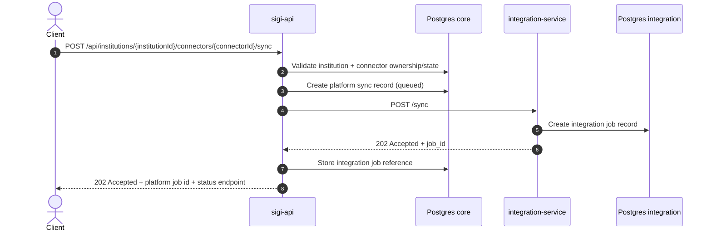
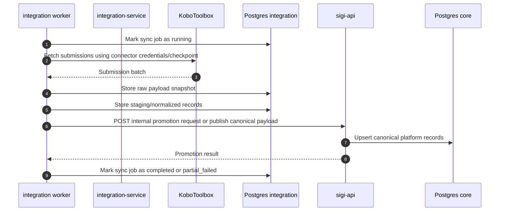
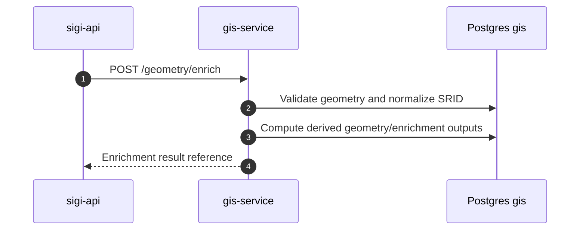
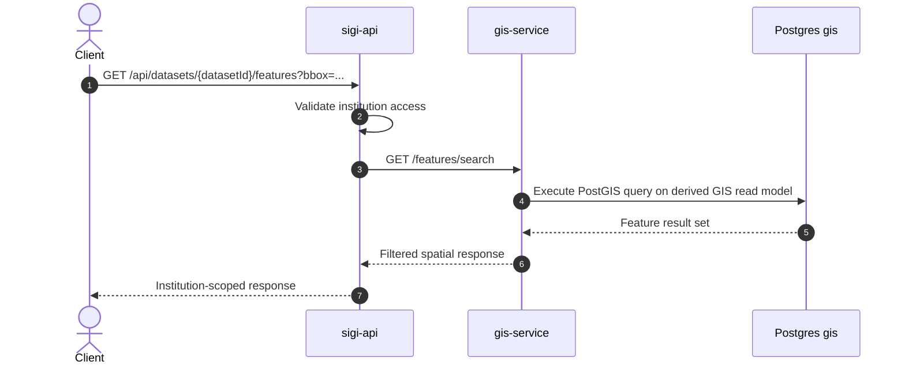
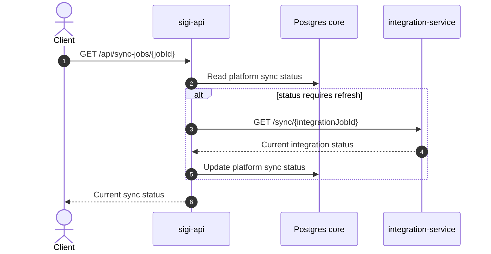
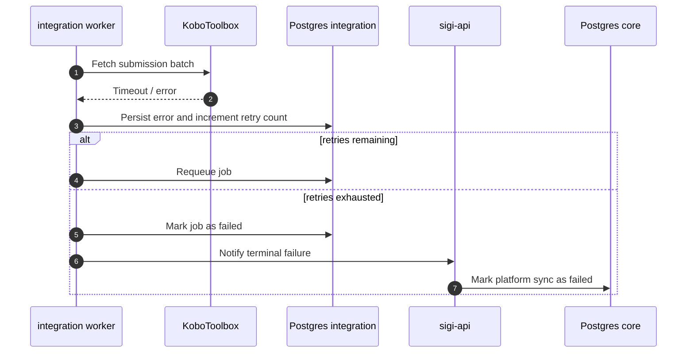

# SIGI Platform V1 Sequence Diagrams

## Purpose

This document translates the SIGI V1 architecture into concrete request and processing sequences.

These flows are intentionally opinionated:

- `sigi-api` is the only public API
- `integration-service` handles ETL and connector execution
- `gis-service` handles spatial processing and GIS read models
- long-running operations are asynchronous

## 1. Kobo Sync Submission Flow

### Intent

A user or scheduler requests a sync for an institution-specific connector.

### Sequence

### Notes

- The client does not call `integration-service` directly.
- `sigi-api` owns authorization and institution validation.
- `integration-service` returns an internal job reference.

## 2. Kobo Extraction and Normalization Flow

### Intent

The integration worker extracts data from KoboToolbox, stores raw data, and prepares canonical records.

### Sequence

### Notes

- Raw data and canonical data must stay separated.
- Promotion into `core` should remain controlled by the platform boundary.
- Failed transforms should be persisted, not dropped.

## 3. GIS Enrichment Trigger Flow

### Intent

Canonical records with geometry trigger downstream spatial validation and enrichment.

### Sequence

### Notes

- This may be synchronous for very small workloads, but V1 should prefer async when enrichment becomes expensive.
- `gis-service` owns spatially optimized outputs, not platform business ownership.

## 4. Spatial Query Flow

### Intent

A client requests institution-scoped spatial data through the public API.

### Sequence

### Notes

- Public clients still talk only to `sigi-api`.
- `gis-service` executes the heavy spatial query.

## 5. Sync Status Flow

### Intent

The client checks sync progress from the platform boundary.

### Sequence

### Notes

- The public source of truth for status is `sigi-api`.
- Internal status may be synchronized from `integration-service`.

## 6. Failure and Retry Flow

### Intent

A Kobo sync fails due to source or network issues.

### Sequence

### Notes

- Retry state belongs in `integration`.
- User-facing failure state belongs in `core`.

## 7. Suggested Correlation Model

Every flow should carry:

- `institution_id`
- `connector_id`
- `platform_job_id`
- `integration_job_id` when applicable
- request or correlation id

These should appear in:

- logs
- job tables
- status payloads
- downstream service calls
